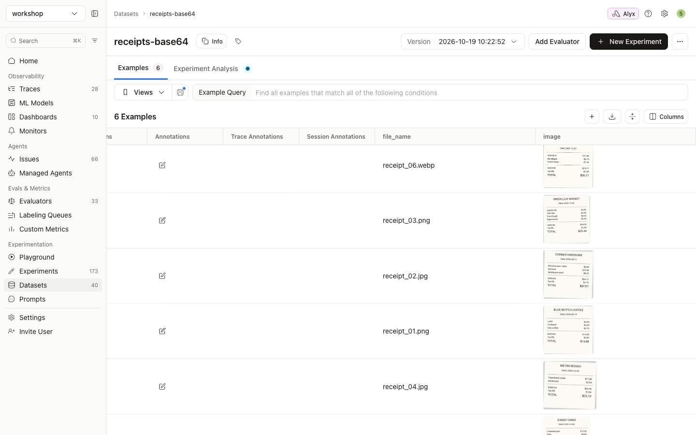
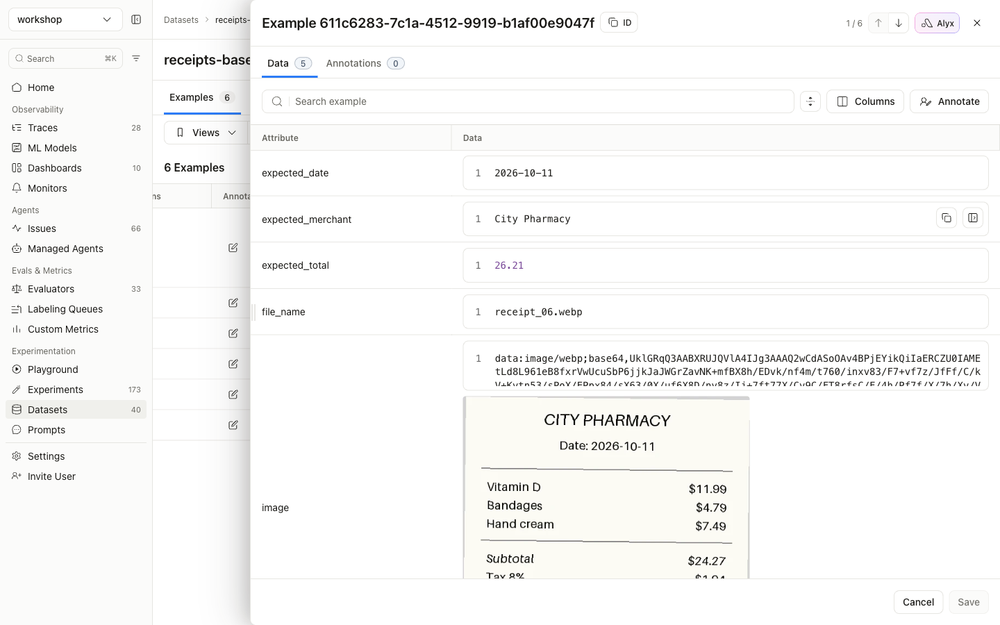
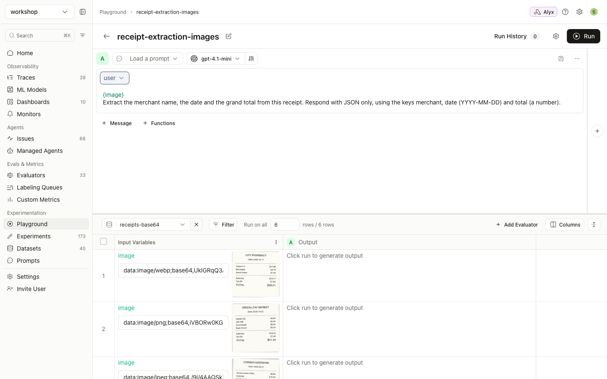
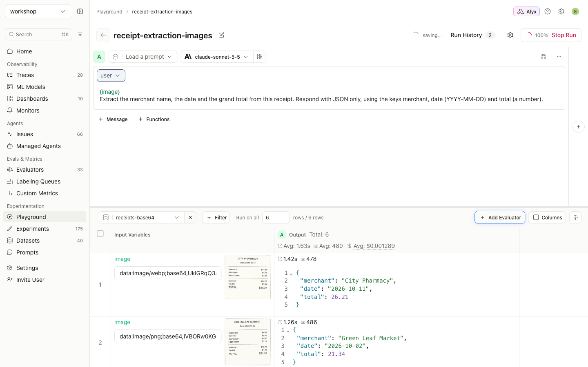

# Guide 1: Base64 images

[← All guides](README.md)

With this approach each dataset row contains the image itself. You don't need to host the images or manage URL expiry, and every vision provider accepts it.

**What you'll build:** a `receipts-base64` dataset, and a Playground run in which a vision model reads each receipt.

## Step 1: Encode the images as data URIs

Store each image as `data:image/<format>;base64,<data>`. Raw base64 without the prefix also works, but the data URI states the format explicitly.

```python
import base64
import mimetypes
from pathlib import Path

ALLOWED = {"image/png", "image/jpeg", "image/gif", "image/webp"}
mimetypes.add_type("image/webp", ".webp")

def to_data_uri(path: Path) -> str:
    """Encode an image file as `data:image/<fmt>;base64,<data>`."""
    mime, _ = mimetypes.guess_type(path.name)
    if mime not in ALLOWED:
        raise ValueError(f"{path.name}: {mime} is not supported (use png/jpeg/gif/webp)")
    b64 = base64.b64encode(path.read_bytes()).decode("ascii")
    return f"data:{mime};base64,{b64}"
```

**Large photos:** resize them before encoding. That keeps the dataset small and stays under provider limits (Anthropic allows about 5 MB per image):

```python
from io import BytesIO
from PIL import Image

def to_data_uri_resized(path: Path, max_side: int = 1568) -> str:
    img = Image.open(path).convert("RGB")
    img.thumbnail((max_side, max_side))
    buf = BytesIO()
    img.save(buf, format="JPEG", quality=85)
    return "data:image/jpeg;base64," + base64.b64encode(buf.getvalue()).decode("ascii")
```

## Step 2: Create the dataset

The full script is [`examples/01_create_base64_dataset.py`](https://github.com/seanlee10/arize-image-inference/blob/main/examples/01_create_base64_dataset.py). Its core:

```python
import os
from arize import ArizeClient

examples = [
    {
        "image": to_data_uri(images_dir / row["file_name"]),  # the image column
        "file_name": row["file_name"],
        "expected_merchant": row["merchant"],                  # ground truth for scoring
        "expected_date": row["date"],
        "expected_total": row["total"],
    }
    for row in ground_truth
]

client = ArizeClient(api_key=os.environ["ARIZE_API_KEY"])
dataset = client.datasets.create(
    name="receipts-base64",
    space=os.environ["ARIZE_SPACE_ID"],
    examples=examples,          # a list of dicts or a pandas DataFrame
)
```

```console
$ python 01_create_base64_dataset.py
Created dataset 'receipts-base64' (RGF0YXNldDozNzA2NDU6NHQ0bw==) with 6 examples
```

Open the dataset under **Datasets**. Thumbnails in the `image` column confirm that Arize recognized the values as images. Hover over a cell to load its thumbnail.



Click a row to see the raw data URI with the image rendered below it:



**Using a CSV upload instead:** write the same rows with `pandas.DataFrame(examples).to_csv("receipts.csv", index=False)` and upload the file under **Datasets → New Dataset**. Base64 makes CSVs large quickly, so for more than a few hundred images use the SDK, which streams large uploads.

## Step 3: Run it in the Prompt Playground

1. Go to **Playground → New Playground → Prompt Playground**.
2. **Choose a vision-capable model.** These screenshots use `claude-sonnet-5-5` through an Anthropic AI integration. GPT-4.1 / 4o / 5 and Gemini also work.
3. **Write the user message** with the image variable on its own line:

   ```
   {image}
   Extract the merchant name, the date and the grand total from this receipt. Respond with JSON only, using the keys merchant, date (YYYY-MM-DD) and total (a number).
   ```

   This playground uses f-string variables (`{image}`). With mustache formatting, write `{{image}}`. Avoid literal `{ }` in the instructions: in f-string mode they are parsed as variables. That's why the prompt above describes the JSON keys in words.
4. **Select the dataset** in the picker at the bottom (`receipts-base64`). Each row's `image` variable gets a preview, which means Arize will send it as an image:

   

5. **Click Run.** Every row is sent to the model with its image:

   

Running the Playground over a dataset also saves the run as an **experiment** on that dataset (**Datasets → receipts-base64 → Experiment Analysis**). You can compare it there with later runs that use a different model or prompt.

## Next

- [Guide 2](02-url-images.md): the same workflow with image URLs
- [Guide 3](03-images-in-evaluators.md): grading the outputs with an evaluator that looks at the image
- [Guide 4](04-experiments-from-code.md): running this from Python
