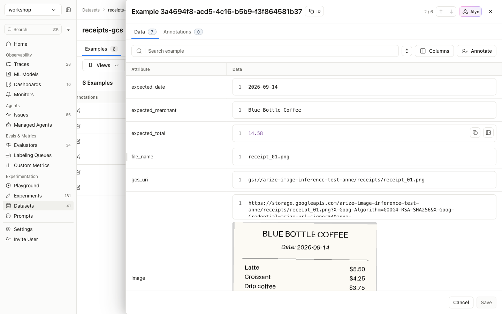
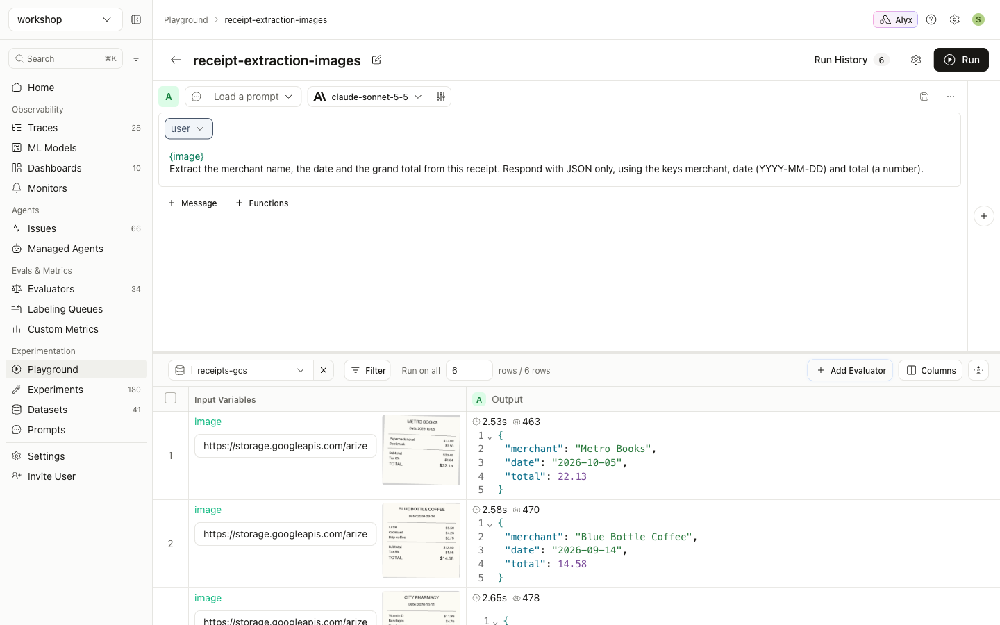
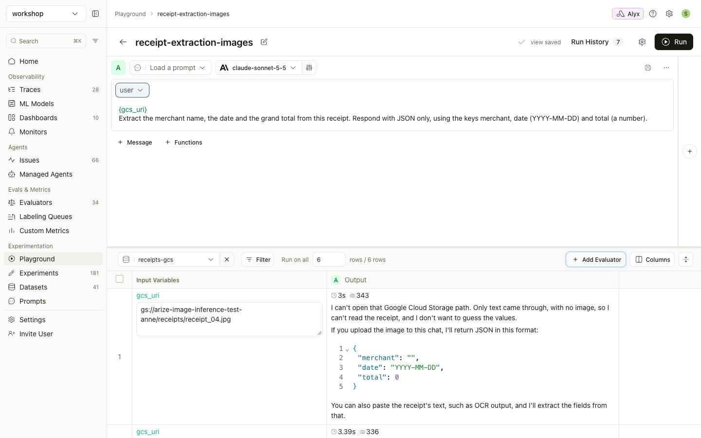

# Guide 2: URL images

[← All guides](README.md)

With this approach each dataset row stores an **https link** to the image. The dataset stays small, but the link has to work when the prompt runs.

**What you'll build:** a `receipts-urls` dataset that points at images hosted on this site, and a Playground run over it.

## URL requirements

| Rule | ✅ Works | ❌ Sent as text |
|---|---|---|
| Must use `https://` | `https://cdn.example.com/r/123.png` | `gs://bucket/r/123.png`, `s3://bucket/r/123.png` |
| The path must end in `.jpg`, `.jpeg`, `.png`, `.gif` or `.webp` | `https://bucket.s3.amazonaws.com/r/1.jpg?X-Amz-Signature=...` | `https://cdn.example.com/img/12345` |
| Must be publicly reachable | Public CDN, presigned URL | VPN-only host, private IP |
| Must still be valid at run time | Presigned URL with a long enough expiry | An expired presigned URL |

## Step 1: Create the dataset

The full script is [`examples/02_create_url_dataset.py`](https://github.com/seanlee10/arize-image-inference/blob/main/examples/02_create_url_dataset.py). It points at the sample receipts on this repo's Pages site by default. Use `--base-url` to point it at your own host.

```python
import json

BASE = "https://seanlee10.github.io/arize-image-inference/examples/images"

examples = []
for row in ground_truth:
    url = f"{BASE}/{row['file_name']}"
    examples.append({
        "image": url,                                    # used by the Playground and experiments
        "image_node": json.dumps({"image.url": url}),    # used by evaluators (guide 3)
        "file_name": row["file_name"],
        "expected_merchant": row["merchant"],
        "expected_date": row["date"],
        "expected_total": row["total"],
    })

client.datasets.create(name="receipts-urls", space=os.environ["ARIZE_SPACE_ID"], examples=examples)
```

Arize fetches the URLs to render thumbnails in the dataset view:


## Step 2: Run it in the Playground

These are the same steps as [guide 1, step 3](01-base64-images.md#step-3-run-it-in-the-prompt-playground). Select `receipts-urls` instead and click **Run**:


## `gs://` and `s3://` URIs are not images

Arize does not sign bucket URIs in the Playground or in experiments, so the model receives the literal text. In this run the `image` variable was set to `gs://my-company-receipts/2026/receipt_01.png`. The prompt still worked, but the model only received the string:


Convert the URIs first, using either of these:

- **Presigned https URLs** (walkthrough below). This is quick, but the URLs expire, so re-sign them for later re-runs.
- **Base64** ([guide 1](01-base64-images.md)). Use this when re-runs need to keep working.

## Walkthrough: images in a private GCS bucket

This was run end to end against a **private** bucket (public access prevention enforced). The receipts were uploaded under `gs://<bucket>/receipts/`.

### Step 1: One-time GCP setup: a signing service account

GCS V4 signed URLs must be signed by a **service account**. User credentials from `gcloud auth application-default login` can read objects but cannot sign. Rather than downloading a key file, create a service account and sign by **impersonating** it:

```bash
PROJECT=my-project
BUCKET=my-receipts-bucket
SA=arize-url-signer@$PROJECT.iam.gserviceaccount.com

# Impersonation-based signing goes through this API
gcloud services enable iamcredentials.googleapis.com --project $PROJECT

gcloud iam service-accounts create arize-url-signer --project $PROJECT

# The service account can only read the bucket
gcloud storage buckets add-iam-policy-binding gs://$BUCKET \
  --member serviceAccount:$SA --role roles/storage.objectViewer

# You (or your CI identity) can sign as the service account
gcloud iam service-accounts add-iam-policy-binding $SA --project $PROJECT \
  --member user:you@example.com --role roles/iam.serviceAccountTokenCreator
```

A signed URL only works if the signer can read the object. The `objectViewer` grant is what makes the link valid.

### Step 2: Sign and create the dataset

[`examples/sign_urls.py`](https://github.com/seanlee10/arize-image-inference/blob/main/examples/sign_urls.py) signs through impersonation:

```python
import google.auth
from google.auth import impersonated_credentials
from google.cloud import storage
from datetime import timedelta

def sign_gcs(uri: str, seconds: int = 7 * 24 * 3600, signer: str | None = None) -> str:
    credentials = None
    if signer:
        source, _ = google.auth.default()
        credentials = impersonated_credentials.Credentials(
            source_credentials=source,
            target_principal=signer,
            target_scopes=["https://www.googleapis.com/auth/cloud-platform"],
        )
    bucket, blob = uri.removeprefix("gs://").split("/", 1)
    return (storage.Client(credentials=credentials).bucket(bucket).blob(blob)
            .generate_signed_url(version="v4", expiration=timedelta(seconds=seconds),
                                 method="GET", credentials=credentials))
```

[`examples/05_create_gcs_dataset.py`](https://github.com/seanlee10/arize-image-inference/blob/main/examples/05_create_gcs_dataset.py) keeps the original URI for reference and puts the signed URL in `image`:

```python
examples.append({
    "gcs_uri": gcs_uri,                                  # reference only: sent as plain text
    "image": sign_gcs(gcs_uri, SEVEN_DAYS, signer),      # signed https URL: sent as an image
    "image_node": json.dumps({"image.url": url}),        # for evaluators (guide 3)
    ...
})
```

```console
$ python 05_create_gcs_dataset.py --bucket my-receipts-bucket --prefix receipts/ \
    --signer arize-url-signer@my-project.iam.gserviceaccount.com
Created dataset 'receipts-gcs' (RGF0YXNldDozNzA2NTQ6S3JIag==) with 6 examples
URLs expire in 168 hours; re-run this script to re-sign them.
```

The row detail view shows the signed URL with the image rendered from it:



The **examples table** shows *"Unable to load image"* for these rows. This is a display limit only: the table cuts cell values to 200 characters, and a V4 signed URL is about 800. The row detail view, the Playground, experiments and evaluators all get the full URL.

### Step 3: Run it: signed URL vs raw `gs://`

**`{image}` (the signed URL):** the model reads every receipt from the private bucket.



**`{gcs_uri}` (the raw `gs://` URI), same dataset and same bucket:** the model gets text only.



Results on this dataset:

| Path | Result |
|---|---|
| Playground, `{image}` | 6/6 correct |
| Playground, `{gcs_uri}` | 0/6. The model reports it received only text |
| Server-side experiment ([guide 4](04-experiments-from-code.md)) | total, merchant and date all 6/6 |
| Image evaluator mapped to `image_node` ([guide 3](03-images-in-evaluators.md)) | 6/6 `correct` |

### Expiry

V4 signed URLs last at most **7 days**. After that, re-runs fail with 400/403 errors from the provider. Re-run `05_create_gcs_dataset.py` to create a fresh dataset, or use base64 if the dataset must stay usable.

### S3

```python
import boto3

def sign_s3(uri: str, seconds: int = 7 * 24 * 3600) -> str:
    bucket, key = uri.removeprefix("s3://").split("/", 1)
    return boto3.client("s3").generate_presigned_url(
        "get_object", Params={"Bucket": bucket, "Key": key}, ExpiresIn=seconds)
```

S3 URLs signed with STS or SSO session credentials expire when that session does, which can be well before the 7 days you asked for. Sign with long-lived credentials if you need the full 7 days.

Both signers keep the object key, including its `.png`/`.jpg` extension, in the URL path, so the extension rule still holds.

## Provider notes

- **OpenAI, Anthropic, Gemini/Vertex, and Bedrock with bearer-token auth** accept https image URLs.
- **Bedrock with IAM or access-key auth running a Claude model** accepts only base64 PNG or JPEG. Use [guide 1](01-base64-images.md) there.
- **Azure OpenAI and other OpenAI-compatible endpoints** fetch the URL themselves. The host must allow the provider's servers to download it.
