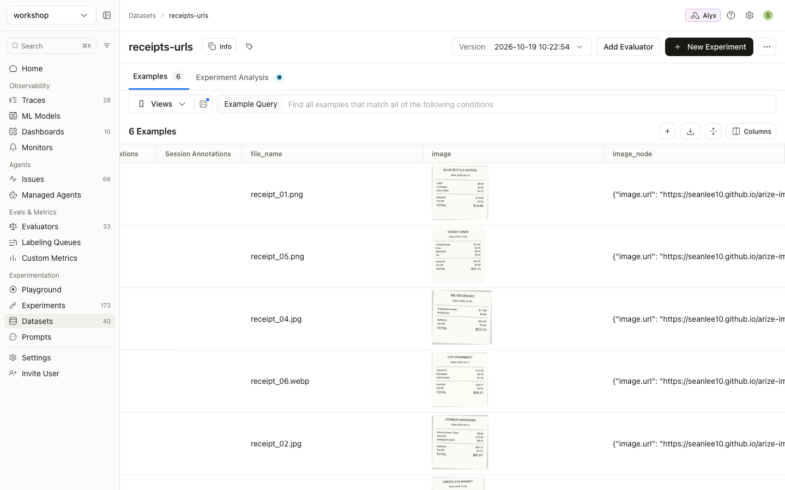
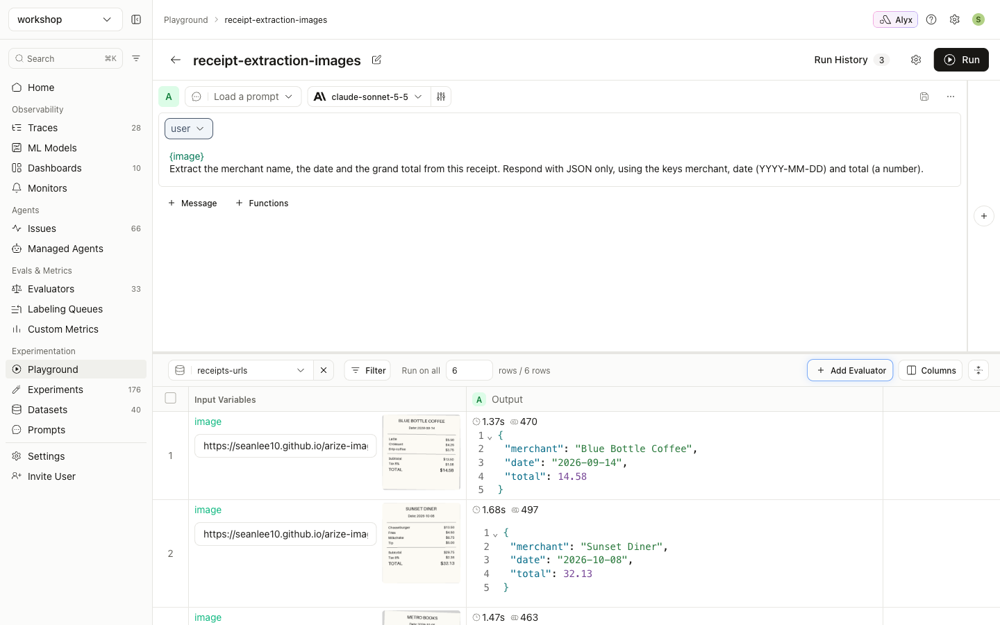

# Guide 2: URL images

[← All guides](README.md)

With this approach each dataset row stores an **https link** to the image. The dataset stays small, but the link has to work when the prompt runs.

**What you'll build:** a `receipts-urls` dataset that points at images hosted on this site, and a Playground run over it.

## URL requirements

| Rule | ✅ Works | ❌ Sent as text |
|---|---|---|
| Must use `https://` | `https://cdn.example.com/r/123.png` | `gs://bucket/r/123.png`, `s3://bucket/r/123.png` |
| The path must end in `.jpg`, `.jpeg`, `.png`, `.gif` or `.webp` | `https://bucket.s3.amazonaws.com/r/1.jpg?X-Amz-Signature=...` | `https://cdn.example.com/img/12345` |
| Must be publicly reachable | Public CDN, presigned URL | VPN-only host, private IP |
| Must still be valid at run time | Presigned URL with a long enough expiry | An expired presigned URL |

## Step 1: Create the dataset

The full script is [`examples/02_create_url_dataset.py`](https://github.com/seanlee10/arize-image-inference/blob/main/examples/02_create_url_dataset.py). It points at the sample receipts on this repo's Pages site by default. Use `--base-url` to point it at your own host.

```python
import json

BASE = "https://seanlee10.github.io/arize-image-inference/examples/images"

examples = []
for row in ground_truth:
    url = f"{BASE}/{row['file_name']}"
    examples.append({
        "image": url,                                    # used by the Playground and experiments
        "image_node": json.dumps({"image.url": url}),    # used by evaluators (guide 3)
        "file_name": row["file_name"],
        "expected_merchant": row["merchant"],
        "expected_date": row["date"],
        "expected_total": row["total"],
    })

client.datasets.create(name="receipts-urls", space=os.environ["ARIZE_SPACE_ID"], examples=examples)
```

Arize fetches the URLs to render thumbnails in the dataset view:



## Step 2: Run it in the Playground

These are the same steps as [guide 1, step 3](01-base64-images.md#step-3-run-it-in-the-prompt-playground). Select `receipts-urls` instead and click **Run**:



## `gs://` and `s3://` URIs are not images

Arize does not sign bucket URIs in the Playground or in experiments, so the model receives the literal text. In this run the `image` variable was set to `gs://my-company-receipts/2026/receipt_01.png`. The prompt still worked, but the model only received the string:


Convert the URIs first, using either of these:

- **Presigned https URLs** (below). This is quick, but the URLs expire, so re-sign them for later re-runs.
- **Base64** ([guide 1](01-base64-images.md)). Use this when re-runs need to keep working.

### Presigning GCS and S3 objects

The script is [`examples/sign_urls.py`](https://github.com/seanlee10/arize-image-inference/blob/main/examples/sign_urls.py):

```python
from datetime import timedelta

SEVEN_DAYS = 7 * 24 * 3600  # the maximum for both GCS V4 and S3 SigV4

def sign_gcs(uri: str, seconds: int = SEVEN_DAYS) -> str:
    from google.cloud import storage
    bucket, blob = uri.removeprefix("gs://").split("/", 1)
    return (storage.Client().bucket(bucket).blob(blob)
            .generate_signed_url(version="v4", expiration=timedelta(seconds=seconds), method="GET"))

def sign_s3(uri: str, seconds: int = SEVEN_DAYS) -> str:
    import boto3
    bucket, key = uri.removeprefix("s3://").split("/", 1)
    return boto3.client("s3").generate_presigned_url(
        "get_object", Params={"Bucket": bucket, "Key": key}, ExpiresIn=seconds)

df["image"] = df["gcs_uri"].map(sign_gcs)   # or df["s3_uri"].map(sign_s3)
```

```console
$ python sign_urls.py gs://my-bucket/receipts/receipt_01.png
https://storage.googleapis.com/my-bucket/receipts/receipt_01.png?X-Goog-Algorithm=...&X-Goog-Signature=...
```

Both signers keep the object key, including its `.png`/`.jpg` extension, in the URL path, so the extension rule still holds.

S3 URLs signed with STS or SSO session credentials expire when that session does, which can be well before the 7 days you asked for. Sign with long-lived credentials if you need the full 7 days.

## Provider notes

- **OpenAI, Anthropic, Gemini/Vertex, and Bedrock with bearer-token auth** accept https image URLs.
- **Bedrock with IAM or access-key auth running a Claude model** accepts only base64 PNG or JPEG. Use [guide 1](01-base64-images.md) there.
- **Azure OpenAI and other OpenAI-compatible endpoints** fetch the URL themselves. The host must allow the provider's servers to download it.
