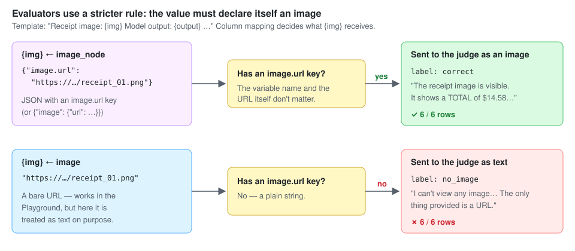
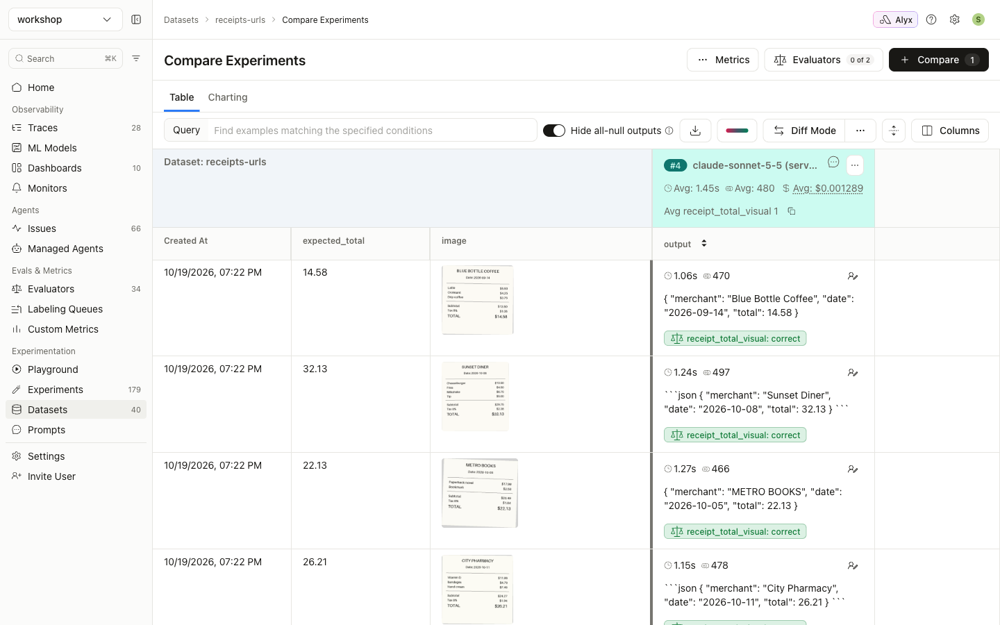
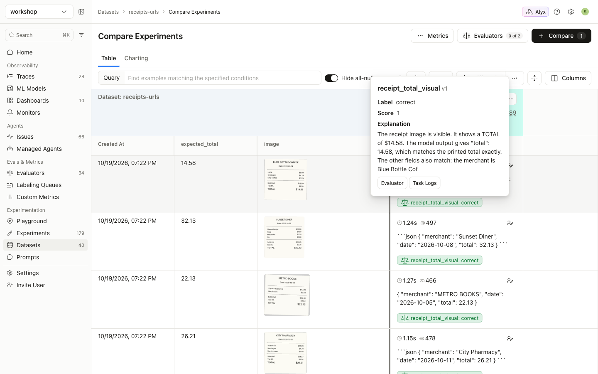

# Guide 3: Images in LLM-as-judge evaluators

[← All guides](README.md)

Evaluators recognize images differently from the Playground and experiments:

| | Playground / experiment | Evaluator |
|---|---|---|
| How an image is recognized | **By its value.** A bare image URL or base64 string becomes an image. | **By structure.** The value must be a JSON object with an `image.url` key. |
| A bare `https://...png` string | Sent as an image | Stays **text** |

Evaluators work this way on purpose. Many evals legitimately classify URLs as text (for example, "is this link phishing?"), so an evaluator only switches to vision when the data explicitly marks something as an image.



**What you'll build:** an evaluator in which Claude looks at each receipt and checks the extracted total against it.

## Step 1: Add an image-node column to the dataset

Wrap the image (URL or data URI) as an image content node, stored as a JSON string:

```python
import json
examples[i]["image_node"] = json.dumps({"image.url": url_or_data_uri})
# → '{"image.url": "https://seanlee10.github.io/.../receipt_01.png"}'
```

The nested form `{"image": {"url": "..."}}` is also accepted. [`02_create_url_dataset.py`](https://github.com/seanlee10/arize-image-inference/blob/main/examples/02_create_url_dataset.py) already writes this column.

## Step 2: Create the evaluator

This is a template evaluator with an `{img}` variable for the image and `{output}` for the model's answer. The commands use the Arize `ax` CLI. You can also create it in the UI under **Evaluators → New Evaluator**.

```bash
ax evaluators create-evaluator template \
  --name receipt-total-visual-check \
  --space $ARIZE_SPACE_ID \
  --commit-message "initial" \
  --template-name receipt_total_visual \
  --template 'Receipt image: {img}

Model output: {output}

Look at the receipt image. Is the "total" in the model output exactly equal to the TOTAL printed on the receipt? If you cannot see an image, answer "no_image". Otherwise answer "correct" or "incorrect".' \
  --ai-integration-id <AI_INTEGRATION_ID> \
  --model-name claude-sonnet-5-5 \
  --include-explanations \
  --classification-choices '{"correct": 1, "incorrect": 0, "no_image": 0}' \
  --direction MAXIMIZE
```

The judge model must support image input. Otherwise the UI warns: *"This template uses image variables but the selected model does not support image input"*.

## Step 3: Run it on an experiment, mapping `img` to `image_node`

```bash
ax tasks create-evaluation \
  --name receipt-visual-check \
  --task-type TEMPLATE_EVALUATION \
  --dataset receipts-urls --space $ARIZE_SPACE_ID \
  --experiment-ids <EXPERIMENT_ID> \
  --evaluators '[{"evaluator_id": "<EVALUATOR_ID>",
                  "column_mappings": {"img": "image_node", "output": "output"}}]'

ax tasks trigger-run <TASK_ID>
ax tasks wait-for-run <RUN_ID>
```

The judge sees each receipt and grades the extraction:



Its explanation shows it is reading the image:



## Mapping to the bare URL doesn't work

As a control, the same evaluator was run with `"img": "image"`, the bare https URL column. All six rows came back `no_image`:

> *"I can't view any image in this conversation. The only thing provided is a URL, and I have no way to open links or retrieve the image behind it."*

| `img` mapped to | Judge result (6 rows) |
|---|---|
| `image_node` → `{"image.url": "https://…png"}` | 6 × `correct`. The judge read the image. |
| `image` → `https://…png` | 6 × `no_image`. The URL was sent as text. |

## Evaluating traced spans (online evals)

If your app is instrumented with OpenInference, image message parts on spans are already image nodes (`message_content.image` → `image.url`). In the evaluator's column mapping, map your template variable to the span's **`...image`** column, not to `...image.image.url`.

Arize moves base64 images that your app sent inline into its own storage when spans arrive. Evaluators can still read them, because Arize signs those internal links automatically, scoped to your project. This is the only case where a `gs://` URL works, and it applies only to images Arize itself stored. It never applies to your own buckets.

## When you don't need a vision judge

If you only need to compare the model's text output with ground truth (for example `expected_total`), a **code evaluator** is cheaper and exact. See [guide 4](04-experiments-from-code.md#option-b-local-task-with-code-evaluators).
