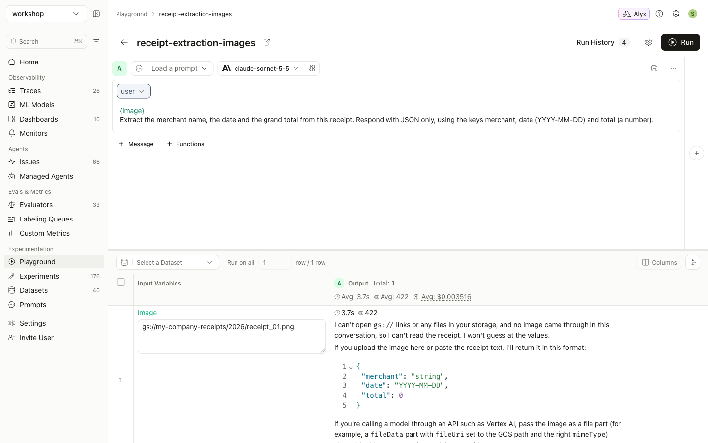

# Guide 5: Troubleshooting

[← All guides](README.md)

## Quick reference

| Symptom | Cause | Fix |
|---|---|---|
| The model says it can't see an image, or quotes a URL back | The value wasn't recognized as an image: `gs://`/`s3://`, no file extension, or an unsupported format | Use an https URL ending in `.png`/`.jpg`/`.jpeg`/`.gif`/`.webp`, or base64 ([guide 2](02-url-images.md#gs-and-s3-uris-are-not-images)) |
| No thumbnail or preview next to the variable in the Playground | Same as above. A preview appears only when Arize treats the value as an image | Same as above |
| `400 messages[0].content must be a string` | The model is text-only | [Choose a vision model](#text-only-model) |
| An LLM judge answers as though there is no image | The evaluator variable is mapped to a bare URL | Map it to an `{"image.url": ...}` column ([guide 3](03-images-in-evaluators.md)) |
| Worked yesterday, fails today with 403 / "could not download" | A presigned URL expired | Re-sign the URLs, or switch to base64 |
| The dataset table shows "Unable to load image" for presigned URLs, but the row detail view shows the image | The table cuts cell values to 200 characters, and signed URLs are about 800 | Display only. Inference, experiments and evaluators get the full URL ([guide 2](02-url-images.md#step-2-sign-and-create-the-dataset)) |
| GCS signing fails: `IAM Service Account Credentials API has not been used ... or it is disabled` | Impersonation signing needs that API | `gcloud services enable iamcredentials.googleapis.com` and wait a minute or two |
| GCS signing fails with 403 `iam.serviceAccounts.signBlob` | You can't impersonate the signer | Grant yourself `roles/iam.serviceAccountTokenCreator` on the service account |
| GCS calls fail with `401 HTTP Basic Authentication is not supported` | A `~/.netrc` entry for `storage.googleapis.com` overrides the OAuth token in Python and gcloud | Remove that entry, or run with `NETRC=/dev/null` |
| A provider 400 error about image size | The image is too large (Anthropic: about 5 MB per image) | Resize before encoding ([guide 1](01-base64-images.md#step-1-encode-the-images-as-data-uris)) |
| "Invalid image URL format for Anthropic model. Please use a base64 data URL instead" | Bedrock with IAM/access-key auth running Claude accepts only base64 PNG/JPEG | Use base64 PNG or JPEG |
| The image is ignored when it sits in a system message | Images are only taken from **user** messages | Move `{image}` into a user message |
| `{` `}` in the instructions turn into stray variables | f-string templates treat any `{...}` as a variable | Describe the JSON in words, or switch the template to mustache (`{{image}}`) |
| `ValueError: Two evaluators have the same name` (SDK) | Evaluators generated by a shared wrapper have the same function name | Define each evaluator as its own function ([guide 4](04-experiments-from-code.md#option-b-local-task-with-code-evaluators)) |
| The SDK's `list_runs(all=True)` errors right after a run finishes | Results aren't queryable yet | Use `limit=100`, or retry after a few seconds |

## `gs://` URI sent as text

## Text-only model

`gpt-oss-20b` (shown here through Groq) has no image input. Arize sends the image as an image part, and the provider rejects the whole request:

![LLM Provider Error: messages[0].content must be a string](assets/screenshots/09-text-only-model-error.png)

Choose a model that supports image input, for example Claude Sonnet, Opus or Haiku (4.x and later) through an Anthropic AI integration. If your AI integration lists models explicitly, add the vision model to the integration's model list first.

## Checking what Arize will send

- **In the Playground:** each variable that will be sent as an image shows a thumbnail next to its value (see [guide 1, step 3](01-base64-images.md#step-3-run-it-in-the-prompt-playground)). No thumbnail means the value goes as text.
- **In a dataset:** the `image` column shows thumbnails. A plain string means Arize doesn't see an image there.
